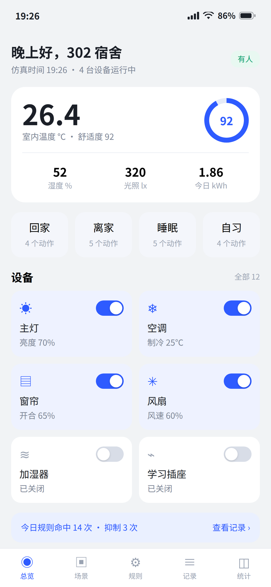
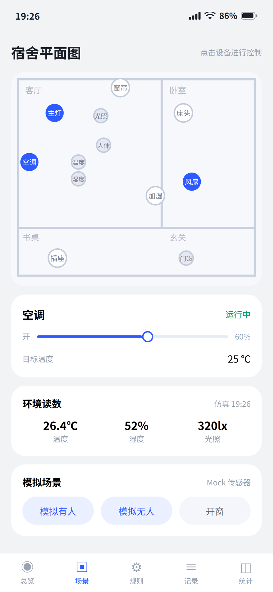
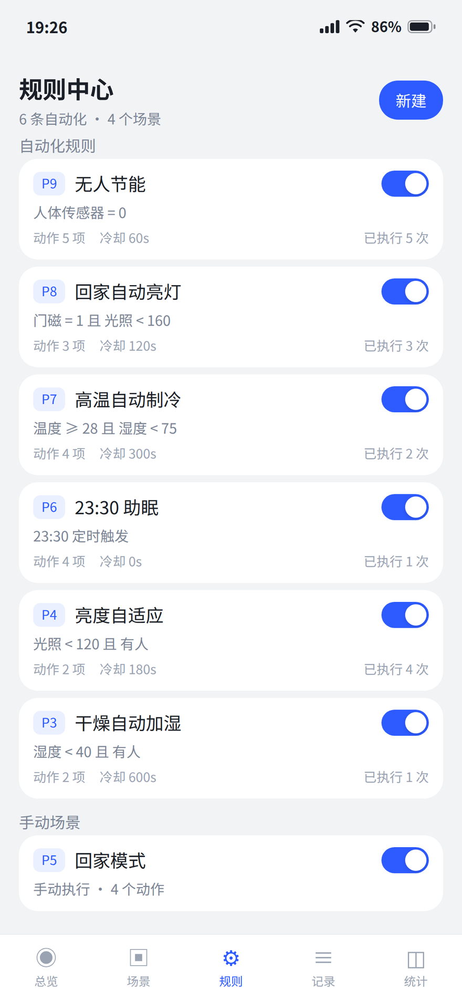
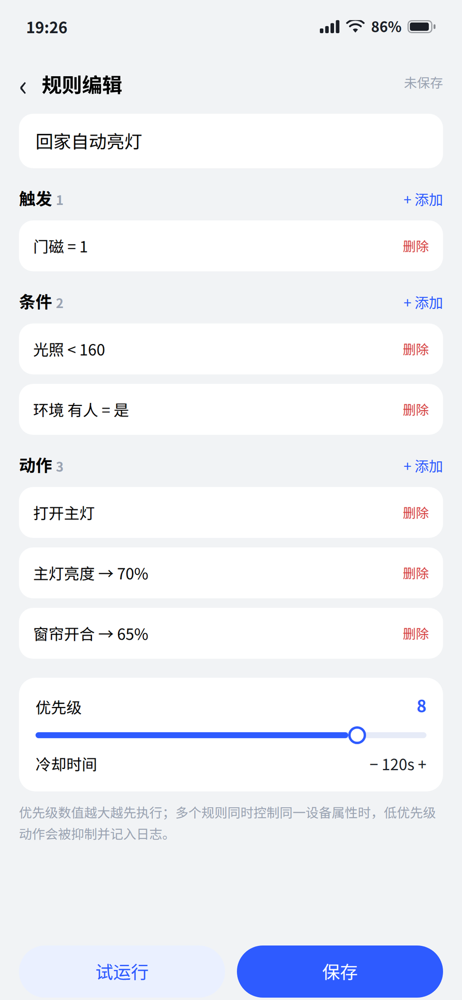
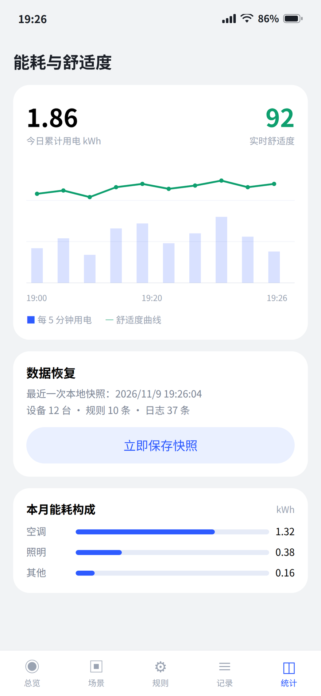
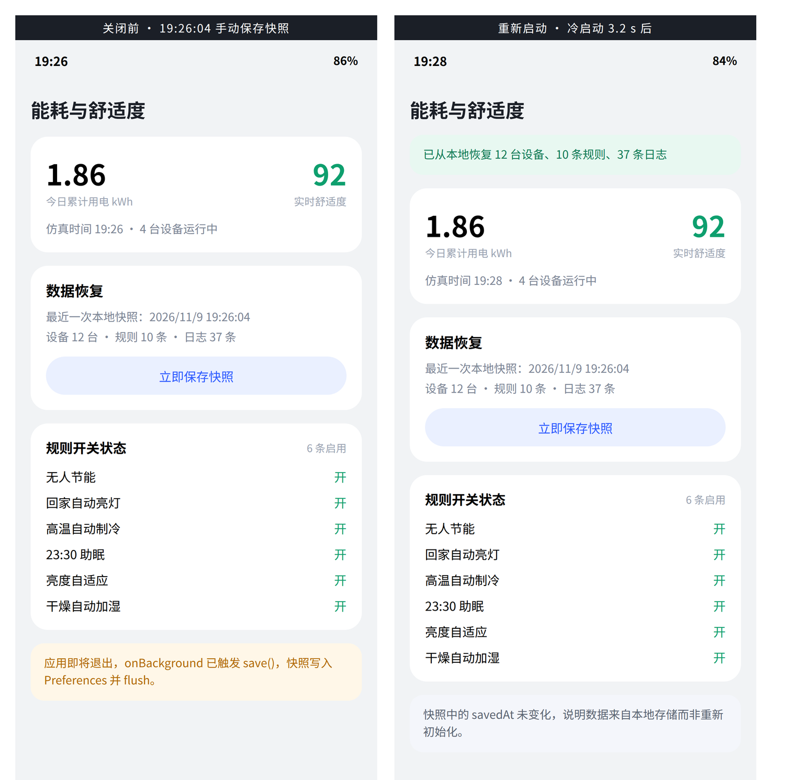

# 寓见 · 智能宿舍场景联动与交互仿真系统

> 移动应用开发基础 · 期末大作业 · 主题三（智能场景规则编排与交互仿真系统）
> HarmonyOS / ArkTS / ArkUI（Stage 模型，API 12）

「寓见」把一间四人宿舍抽象成 **12 台设备** + **一套规则引擎**。用户既可以直接控制设备，也可以把"什么时候、满足什么条件、做什么"写成规则，交给系统在每个仿真分钟内自动判定、执行、并留下可追溯的日志。

它不是一个把开关摆在页面上的"遥控器 App"——**核心是一套真实的规则执行链路**：

```
环境仿真 → 属性差分 → 触发匹配 → 条件判定 → 优先级排序 → 冲突消解 → 冷却校验 → 动作执行 → 日志落盘
```

因此界面上看到的不是"灯亮了"，而是"因为门磁打开且光照低于 160 lx，【回家自动亮灯】把主灯调到 70%，同时【亮度自适应】因优先级冲突被抑制"。

---

## 一、功能说明

### 1.1 五个页面

| 页面 | 入口 | 主要内容 |
| --- | --- | --- |
| 总览 | `pages/Index` Tab 1 | 仿真时钟、在室状态、温度/舒适度环形进度、4 个场景快捷键、12 台设备网格 |
| 场景 | Tab 2 | Canvas 绘制的宿舍平面图，点击设备圆点弹出控制面板（滑杆调档、目标温度加减） |
| 规则 | Tab 3 | 自动化规则与手动场景两段列表，显示优先级、触发摘要、动作数、冷却、命中次数 |
| 记录 | Tab 4 | 按时间倒序的执行/抑制/系统日志，按类型筛选 |
| 统计 | Tab 5 | 今日用电、实时舒适度、能耗柱状图、舒适度折线、快照恢复信息 |
| 规则编辑 | `pages/RuleEditorPage` | 触发/条件/动作三段增删、优先级滑杆、冷却计数器、试运行、保存 |

### 1.2 设备（12 台）

主灯、床头灯、空调、窗帘、加湿器、风扇、学习插座，以及人体、门磁、温度、湿度、光照五类传感器。
每台设备统一抽象为 `id / type / name / room / power / level / targetTemp / value`，读写全部经由 `readAttr / writeAttr`，写入时做区间裁剪（档位 0—100、目标温度 16—30 ℃）与同值抑制。

### 1.3 规则引擎

一条规则 = **触发组 + 条件组 + 动作组 + 优先级(1—9) + 冷却(0—600 s) + 启用开关**。

- **触发**：设备属性变化（`门磁 = 1`）、定时（`23:30`）、手动（场景按钮）
- **条件**：对设备或环境的比较式，支持 `= ≠ > ≥ < ≤` 六种算子，多个条件之间为 **AND**
- **动作**：写属性、延时（按仿真时间累加，不阻塞界面）、通知

内置 **6 条自动化规则 + 4 个手动场景**：

| 规则 | 优先级 | 触发 | 动作 |
| --- | --- | --- | --- |
| 无人节能 | P9 | 人体传感器 = 0 | 关主灯/空调/风扇，延时 30 s，通知 |
| 回家自动亮灯 | P8 | 门磁 = 1 且 光照 < 160 且 有人 | 主灯开、亮度 70%、窗帘 65% |
| 高温自动制冷 | P7 | 温度 ≥ 28 且 有人且 湿度 < 75 | 空调 25 ℃、风扇 60%、通知 |
| 23:30 助眠 | P6 | 23:30 定时 | 关主灯、床头灯 25%、窗帘 0、空调 27 ℃ |
| 亮度自适应 | P4 | 光照 < 120 且 有人 | 主灯开、亮度 45% |
| 干燥自动加湿 | P3 | 湿度 < 40 且 有人 | 加湿器开、档位 60% |

> 冲突消解：同一轮内多条规则写同一个"设备.属性"时，按优先级降序抢占，**低优先级整条抑制**并写入原因日志。R1（P8）与 R5（P4）同时命中主灯时，R5 会被抑制而不是"后写覆盖"。

### 1.4 环境仿真

温度用一阶惯性模型推演：每分钟按固定比例向室外温度靠拢，空调开启时再叠加与温差、档位相关的降温量，所以温度不会瞬移，而是可见的下降曲线。光照 = 太阳高度角余弦 × 窗帘开合比例 + 灯具亮度，夜里自然光为 0——这是"回家自动亮灯"能被观察到的前提。舒适度由温度、湿度加权得到，用于统计页折线。

### 1.5 持久化

`preferences` 整包快照：一次 `put` 写入整个 JSON（设备、规则、日志、环境、计量），再 `flush` 落盘；冷启动时 `EntryAbility.onWindowStageCreate` 先 `await` 快照恢复，再 `loadContent`，避免首帧渲染默认值后被回写覆盖。业务状态变化后防抖 800 ms 存盘，`onBackground / onDestroy` 主动存盘。快照解析失败时回退默认配置并提示，不崩溃。

---

## 二、运行截图

| 总览 | 场景 |
| --- | --- |
|  |  |

| 规则中心 | 规则编辑 |
| --- | --- |
|  |  |

| 运行记录 | 能耗与舒适度 |
| --- | --- |
|  |  |

**重启前后数据一致**（改—存—杀—启）：



---

## 三、开发环境

| 项 | 版本 / 说明 |
| --- | --- |
| IDE | DevEco Studio 5.0.3 Release |
| SDK | HarmonyOS SDK 5.0.0(12)，compatibleSdkVersion `5.0.0(12)` |
| 语言 | ArkTS（Stage 模型），API 12 |
| UI | ArkUI 声明式开发（Tabs / Grid / List / Canvas / Slider / Toggle / Progress） |
| 持久化 | `@kit.ArkData` preferences |
| 运行设备 | Phone 模拟器 1080×2340；Mate 60 Pro 真机 |
| 最低 API | 12 |

应用包名 `com.zhangchi.zhijian`，应用名 **寓见**。

---

## 四、运行方法

1. 安装 DevEco Studio 5.0.3 与 HarmonyOS SDK API 12（首次打开会自动提示下载）。
2. `File → Open` 选择**仓库根目录**（不是 `entry`），等待 Sync 完成。
3. 选择 `entry` 模块，Device Manager 启动 Phone 模拟器，或连接真机并开启开发者模式。
4. 点击 ▶ Run。首次启动写入 Mock 数据（12 台设备、10 条规则），之后每次启动从本地快照恢复。
5. 体验路径建议：
   - 总览页把"有人"切到无人 → 观察【无人节能】执行；
   - 切回有人、把窗帘拉到 0、点场景页主灯 → 观察【回家自动亮灯】与【亮度自适应】的优先级冲突；
   - 规则页进入任一规则 → 改优先级 → 试运行，对比日志里的抑制原因；
   - 统计页"立即保存快照" → 从最近任务划掉应用 → 重新打开，核对设备/规则/日志数与今日用电。
6. 演示录屏：`docs/demo.mp4`（约 2 分 30 秒，覆盖上述全部路径；提交前放入该目录）。

---

## 五、目录结构

```
zhijian-smart-dorm
├─ AppScope/                     应用级配置与图标
├─ entry/src/main/ets/
│  ├─ model/                     DeviceModel.ets  RuleModel.ets        数据模型与序列化
│  ├─ service/                   DeviceService / RuleEngine / EnvironmentService
│  │                             LogService / MetricsService / StoreService
│  ├─ viewmodel/                 DormStore.ets   全局状态中枢 + 仿真时钟
│  ├─ view/                      HomeView / SceneView / RuleView / LogView / StatisticsView
│  ├─ components/                DeviceCard.ets  RuleCard.ets          可复用组件
│  ├─ mock/                      MockSeed.ets    12 台设备 / 10 条规则初始数据
│  ├─ pages/                     Index.ets（Tabs 容器）  RuleEditorPage.ets
│  └─ entryability/              EntryAbility.ets  生命周期与快照恢复
├─ docs/
│  ├─ 软件需求说明书.docx
│  ├─ 软件需求说明书.pdf
│  └─ images/                    运行截图（README 与需求说明书共用）
└─ README.md
```

## 六、代码规模

约 2 470 行 ArkTS/ArkUI：

| 层 | 文件 | 行数 |
| --- | --- | --- |
| model | 2 | 356 |
| service | 5 | 739 |
| viewmodel | 1 | 213 |
| view + components | 7 | 712 |
| mock | 1 | 159 |
| pages + ability | 3 | 293 |
| 合计 | 19 | 2 472 |

## 七、已知限制

- 条件组只支持 AND，暂无 OR 与"时间窗口"（如 22:00—06:00 内生效）。
- 环境模型是简化的线性模型，未考虑房间朝向与人员散热；能耗按额定功率估算，未接真实电表。
- 分布式设备接入（FR-09）尚未实现，规则仅作用于本地模拟设备。

## 八、许可

本项目为课程作业，仅用于教学演示。
